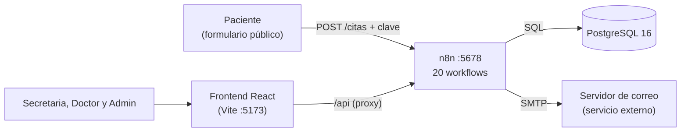

# MediNova

Sistema de **automatización de citas médicas** hecho con **n8n** y **PostgreSQL**, con una interfaz web en **React**. Recibe solicitudes, asigna doctor y horario sin solapes, pide aprobación del doctor con un segundo factor (TOTP), avisa al paciente por correo, le recuerda la cita y deja un registro de auditoría. Todo corre en un solo equipo, con Docker.

Proyecto final individual del curso **Análisis de Sistemas II** (código 037), Universidad Mariano Gálvez de Guatemala.

| | |
|---|---|
| **Autor** | Anthony Alessandro Mó Cu |
| **Docente** | Ing. Edgar Raúl Molina Rey |
| **Versión** | 1.0, octubre de 2026 |

---

## Documentación

Los documentos están en PDF, en una carpeta de Google Drive compartida con el docente.

| Documento | Qué contiene | Enlace |
|---|---|---|
| **Documento técnico** | Resumen ejecutivo, arquitectura, modelo de datos, interfaz, pruebas de integración, seguridad y conclusiones | [Abrir documento](https://drive.google.com/file/d/177ODcK_N8cbHgMVARk81SpxJsaDXGzHe/view?usp=drive_link) |
| **Especificación de workflows** | Tabla por cada uno de los 20 workflows, con sus nodos, el tipo de cada nodo y su descripción | [Abrir documento](https://drive.google.com/file/d/1i0fMKIqBTy1SbdlAhjmK1sIrH2IDdc8z/view?usp=drive_link) |
| **Pruebas unitarias** | Pruebas de la lógica de los nodos Code: casos, entradas y resultados | [Abrir documento](https://drive.google.com/file/d/1UQY5iGso-3_KwIfYymvTi972dRxRrQST/view?usp=drive_link) |
| **Video de demostración** | Un caso normal y un caso de error | [Abrir video](https://drive.google.com/file/d/1Pwi6xZf_nT2GoNxN0qLDf30dOwxMyBFl/view?usp=drive_link) |

La guía de despliegue está en este README, en la sección **Puesta en marcha**.

---

## Arquitectura



- **Interfaz:** React con CSS plano, sin librerías de componentes. Un proxy de Vite reenvía `/api` hacia los webhooks de n8n.
- **Lógica:** 20 workflows de n8n, disparados por peticiones (webhooks) o por tiempo (Schedule Trigger).
- **Datos:** PostgreSQL con volumen persistente. Las restricciones de la base impiden, por ejemplo, que un doctor tenga dos citas solapadas.
- **Servicio externo:** únicamente el servidor SMTP, para el correo.

### Roles

| Rol | Qué puede hacer |
|---|---|
| **Secretaria** | Crear citas, ver toda la agenda, cancelar y atender las solicitudes sin asignar |
| **Doctor** | Ver y aprobar sus citas con su código TOTP, crear citas en su propia agenda y completarlas |
| **Admin** | Todo lo anterior, más usuarios, especialidades, desbloqueos y reportes mensuales |

### Ciclo de vida de una cita

`pendiente` → `pendiente_aprobacion` → `asignada` → `notificada` → `recordada` → `completada`

Una cita también puede quedar `sin_asignar` (no hubo doctor ni hueco) o `cancelada`, que libera el horario.

---

## Contenido del repositorio

```
.
├── docker-compose.yml      Contenedores de n8n y PostgreSQL
├── .env.example            Variables de entorno de ejemplo
├── sql/                    Esquema de la base de datos y catálogo de especialidades
├── workflows/              Los 20 workflows de n8n, en JSON
├── clinicaflow-web/        Interfaz React (Vite)
├── Pruebas_unitarias/      Pruebas de la lógica de los nodos Code
└── subir.sh                Revisa y sube cambios sin exponer secretos
```

---

## Guía de despliegue

### Requisitos previos

- Docker Desktop (o Docker Engine) con Docker Compose v2.
- Node.js 20 o superior, para la interfaz y las pruebas unitarias.
- Git. En Windows, los comandos de esta guía se ejecutan en **Git Bash**.
- Puertos libres: 5678 (n8n) y 5173 (interfaz).
- Una aplicación autenticadora (Microsoft Authenticator o equivalente).
- Opcional: una cuenta de correo con contraseña de aplicación, para el envío real de correo.

### Puesta en marcha

**1. Clonar el repositorio y crear el archivo `.env`.**

```bash
git clone https://github.com/SandroZ115/Proyecto-n8n---Citas-medicas.git
cd Proyecto-n8n---Citas-medicas
cp .env.example .env
```

Abre `.env` y cambia el valor de `POSTGRES_PASSWORD` por una contraseña propia. Este archivo nunca se sube al repositorio.

**2. Levantar los contenedores.**

```bash
docker compose up -d
docker compose ps
```

Los dos contenedores (`postgres` y `n8n`) deben aparecer como `Up`.

**3. Crear la cuenta de propietario de n8n.** Entra a `http://localhost:5678` y completa el formulario del primer inicio. Esa cuenta protege el acceso a n8n, y el puerto solo está abierto en el propio equipo.

**4. Crear las tablas y el catálogo de especialidades.**

```bash
docker compose exec -T postgres psql -U n8n -d n8n < sql/schema.sql
docker compose exec -T postgres psql -U n8n -d n8n < sql/especialidades.sql
```

**5. Crear las credenciales en n8n** (menú *Credentials*):

- **PostgreSQL:** host `postgres`, base `n8n`, usuario `n8n` y la contraseña que pusiste en `.env`.
- **SMTP** (solo si usarás correo): ver la sección *Correo* más abajo.

**6. Importar los workflows.** Ver *Importación de los workflows*.

**7. Crear el primer administrador.** El registro de usuarios exige un administrador existente, así que el primero se inserta directamente en la base. Genera una sal y un secreto TOTP propios:

```bash
# Sal (16 caracteres hexadecimales)
node -e "console.log(require('crypto').randomBytes(8).toString('hex'))"

# Secreto TOTP (16 caracteres del alfabeto A-Z y 2-7)
node -e "const a='ABCDEFGHIJKLMNOPQRSTUVWXYZ234567';let s='';for(let i=0;i<16;i++)s+=a[require('crypto').randomInt(32)];console.log(s)"
```

Abre una sesión de `psql`:

```bash
docker compose exec postgres psql -U n8n -d n8n
```

Y ejecuta el `INSERT`, cambiando el correo, la clave inicial, la sal y el secreto. La contraseña se guarda como SHA-256 de la clave seguida de la sal, el mismo cálculo del workflow de Login:

```sql
INSERT INTO usuarios (correo, password_hash, salt, rol, totp_secret)
VALUES ('admin@ejemplo.com',
        encode(sha256(convert_to('CLAVE_INICIAL' || 'SAL_GENERADA', 'UTF8')), 'hex'),
        'SAL_GENERADA', 'admin', 'SECRETO_GENERADO');
```

Escribe `\q` para salir. Después, agrega una cuenta en la aplicación autenticadora con **entrada manual**, tipo **basado en tiempo**, y el secreto que generaste. Este primer administrador no tiene códigos de respaldo; los demás usuarios se crean desde la aplicación y sí los reciben.

**8. Publicar los workflows.** En n8n, abre cada uno y pulsa *Publish*. Los que tienen webhook o disparador programado solo funcionan una vez publicados.

**9. Iniciar la interfaz.**

```bash
cd clinicaflow-web
npm install
npm run dev
```

La aplicación queda en `http://localhost:5173`. Inicia sesión con el administrador y crea desde ahí a los demás usuarios.

### Importación de los workflows

1. En n8n, abre *Workflows* y elige **Import from File**.
2. Selecciona cada archivo JSON de la carpeta `workflows/` (20 archivos).
3. Abre cada nodo **Postgres** y selecciona la credencial local, porque las credenciales no se exportan. En los nodos **Send Email** de *Salida* y *Recordatorio*, selecciona la credencial SMTP y escribe el remitente.
4. En el nodo **Validar API Key** de *Ingreso*, reemplaza el marcador `CAMBIAR_CLAVE_API` por la clave del servicio. Es la clave que se envía en el encabezado `x-api-key`.
5. Publica el workflow. Los cambios posteriores exigen publicar de nuevo, porque producción ejecuta la última versión publicada.
6. Publica **ERRORES** y asígnalo como *Error Workflow* en *Settings* de cada uno de los demás. La asignación apunta al identificador de ERRORES en cada instalación, por eso no se conserva al importar.

### Correo (opcional)

El aviso al paciente y el recordatorio se envían por correo. Con una cuenta de Gmail:

1. Activa la verificación en dos pasos y crea una **contraseña de aplicación** en `myaccount.google.com/apppasswords`.
2. En n8n, crea una credencial **SMTP**: host `smtp.gmail.com`, usuario con tu correo completo y la contraseña de aplicación sin espacios. Con puerto `465`, activa SSL/TLS; con `587`, déjalo desactivado.
3. Deja vacío el campo *Client Host Name*.

Si no configuras el correo, el sistema funciona igual: las citas sin envío quedan registradas en la bitácora como `notificacion_fallida`.

---

## Pruebas

**Pruebas unitarias.** Verifican la lógica de los nodos Code: TOTP, hash de contraseñas, bloqueo por intentos, validación de citas, tokens y armado de respuestas.

```bash
cd Pruebas_unitarias
node --test
```

> COMPLETAR: confirma que este es el comando exacto que usas, y corrígelo si no lo es.

**Pruebas de integración.** Se ejecutaron con `curl` contra los webhooks y se verificaron en la base de datos. Los casos y sus resultados están en el *Documento técnico*. Una comprobación rápida de que el sistema responde:

```bash
curl -i -X POST http://localhost:5678/webhook/verificar-sesion \
  -H "Authorization: Bearer token-de-prueba"
```

Debe responder `401`, porque el token no existe.

---

## Mantenimiento

- Revisa la pestaña *Executions* de n8n para detectar ejecuciones fallidas, y la bitácora con `accion = 'error'`, `notificacion_fallida` y `recordatorio_fallido`.
- Exporta los workflows en JSON después de cada cambio importante, y respalda la base con `pg_dump`.
- Ajusta el intervalo de los Schedule Trigger de 30 segundos (pruebas) a minutos en uso real.
- Genera el reporte mensual desde la interfaz y conserva los archivos CSV, porque la bitácora puede limpiarse.
- Limpia periódicamente sesiones vencidas y registros de prueba.
- Rota las contraseñas de aplicación y las credenciales, y comprueba que `.env` no esté en el control de versiones.
- Antes de cada demostración, comprueba que los contenedores estén activos y que los webhooks respondan.

### Subir cambios al repositorio

Antes de subir, reemplaza la clave de la API y el correo en los JSON exportados, y usa el script `subir.sh`. Detecta si hay cambios, bloquea la subida si incluiría un archivo `.env`, un token o una cadena de un archivo local de secretos (`.secretos.local`, fuera del control de versiones), y evita que se pierdan workflows.

```bash
./subir.sh "Descripción del cambio"
```

---

## Seguridad

- La contraseña de la base de datos se lee de `.env`, que no se versiona. El repositorio incluye `.env.example` con un valor de muestra.
- Las credenciales de PostgreSQL y SMTP viven en el almacén de credenciales de n8n y no salen en los JSON exportados.
- Las contraseñas de los usuarios se guardan como hash SHA-256 con una sal por usuario.
- Autenticación en dos pasos (TOTP, RFC 6238), con ocho códigos de respaldo de un solo uso y bloqueo de 15 minutos tras tres fallos.
- Los permisos se validan en el servidor en cada petición, y un doctor solo accede a sus propias citas.
- Todas las consultas con datos del usuario son parametrizadas, y se probaron con cargas de inyección SQL.

Las limitaciones reconocidas y sus mejoras están en el *Documento técnico*, sección 6.3.

---

## Herramientas de apoyo

Se usaron asistentes de IA (Claude y OpenCode) como apoyo para depurar workflows y generar código de la interfaz. El diseño, las pruebas y la integración del sistema son del autor.
